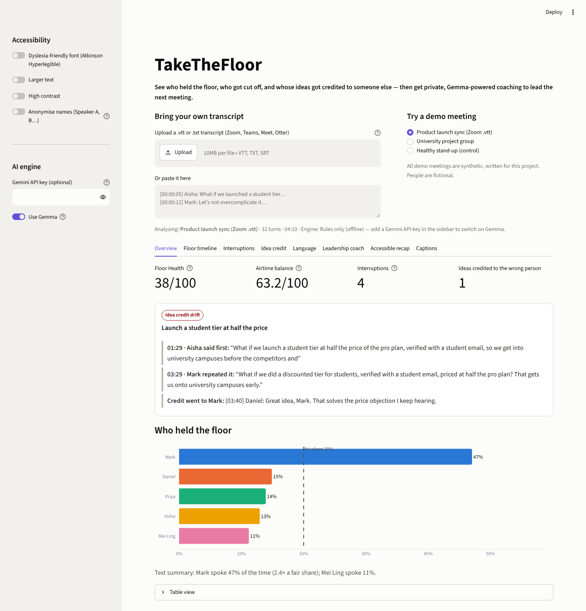
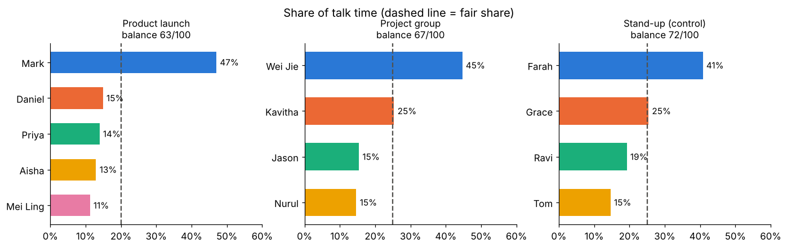

# TakeTheFloor

**See who held the floor, who got cut off, and whose ideas got credited to someone else — then get private, Gemma-powered coaching to lead the next meeting.**

| | |
|---|---|
| **Hackathon** | 305 EmpowHER Edition — October 2026 (Code Crunch Worldwide) |
| **Competition type** | **Analytics Competition** |
| **Theme alignment** | Solutions that improve **accessibility** and **leadership development** outcomes |
| **Opt-in challenges** | LLM Gemma Challenge · Kaggle Challenge |
| **Live app** | https://takethefloor.streamlit.app |
| **Kaggle notebook** | [`notebooks/takethefloor_meeting_equity.ipynb`](notebooks/takethefloor_meeting_equity.ipynb) — KAGGLE_LINK_HERE |
| **Slides** | [`slides/TakeTheFloor_pitch_deck.pptx`](slides/TakeTheFloor_pitch_deck.pptx) · [PDF](slides/TakeTheFloor_pitch_deck.pdf) · Google Slides: GOOGLE_SLIDES_LINK_HERE |
| **10-min feature demo (MP4)** | FEATURE_VIDEO_LINK_HERE |
| **5-min backup demo (MP4)** | BACKUP_VIDEO_LINK_HERE |
| **Team** | Shermaine Yap Shi Min — Asia Pacific University of Technology & Innovation (APU), Malaysia — solo: research, analytics, engineering, design, pitch |



---

## The problem

Leadership is visible in meetings — and quietly lost there. Three patterns are well documented:

1. **Uneven airtime.** In mixed groups, women's share of speaking time often falls below their share of seats unless group rules change (Karpowitz, Mendelberg & Shaker, 2012).
2. **Uneven interruptions.** Experimental work found people interrupted women more often than men (Hancock & Rubin, 2015).
3. **Ideas lose their author.** One person raises an idea, someone else repeats it, and the room credits the repeater. Women staffers in the Obama White House countered this with *amplification* — repeating a colleague's point and naming her (Washington Post, 2016).

None of this shows up in meeting notes, so nobody can fix it. Meanwhile, teammates who are Deaf or hard of hearing, neurodivergent or working in a second language often leave meetings without a clear picture of what was decided.

## The solution

Drop in a meeting transcript (Zoom / Teams / Meet `.vtt`, Otter export, or plain `Name: text`). TakeTheFloor:

| Feature | What it shows |
|---|---|
| **Floor Health score** | One number for the facilitator: airtime balance, minus interruptions and mis-credited ideas, plus credited builds |
| **Airtime** | Each person's share of talk time vs. a fair share (Gini-based balance index) |
| **Floor timeline** | Every turn on a time axis with interruption ▼ and idea ◆/★ markers |
| **Interruption detection** | Cut-offs and overlaps, **told apart from backchannels ("mm-hmm") and supportive "yes, and…" overlap** so friendly energy isn't punished; who-interrupted-whom matrix |
| **Idea credit tracker** | Finds an idea raised by A, repeated by B, and credited to B — with the exact quotes and timestamps. Also celebrates *credited builds* ("Building on Grace's audit…") |
| **Hedge Index** | Pre-apologies, minimisers and self-discounting per 100 words, each with an assertive rewrite |
| **Private leadership coach (Gemma)** | Per-person strengths, next moves, word-for-word scripts and rewrites of their own hedged sentences |
| **Accessible recap (Gemma)** | Plain-language summary, decisions, who-does-what and open questions |
| **Captions** | Speaker-labelled transcript with every event written out in words |
| **Facilitator tips** | Structural fixes: round-robins, a "let them land" norm, naming idea owners in notes |

### The moment it catches (demo meeting)

> **01:29 · Aisha:** "What if we launch a student tier at half the price of the pro plan, verified with a student email…" — *Mark cuts her off.*
> **03:29 · Mark:** "What if we did a discounted tier for students, verified with a student email, priced at half the pro plan?"
> **03:40 · Daniel:** "Great idea, Mark." … "Let's go with Mark's pricing plan."

TakeTheFloor flags this as **credit drift**, and Aisha's private coaching tells her how to reclaim it next time.

## Accessibility (theme alignment)

* **Plain-language recap** for Deaf/HoH, neurodivergent and second-language teammates, or anyone who missed the meeting.
* **Atkinson Hyperlegible** font toggle (designed for low-vision readers), **larger text**, **high-contrast** mode.
* **Never colour-alone:** validated colour-blind-safe palette, names printed on every chart, a text summary under each chart and a **table view**.
* **Captions tab** writes every event in words; visible keyboard focus rings.
* **Anonymise names** (Speaker A, B…) before sharing with a team.

## Leadership development (theme alignment)

Coaching is **private, evidence-based and actionable**: strengths first, then three moves for the next meeting, scripts to say word-for-word ("I'd like to finish my point, then I'd love to hear yours"), and confident rewrites of the person's own hedged sentences. Facilitators get structural fixes — the goal is to change the meeting, not to grade people.

## How it works

```
transcript ─► parser (vtt / [hh:mm:ss] / Otter / plain) ─► merged speaker turns
                 │
                 ├─► airtime + Gini balance ─────────────────────────────┐
                 ├─► interruption candidates (cut-off / overlap) ─► Gemma re-labels: interruption | supportive | backchannel
                 ├─► Hedge Index (13 pattern families) + rule rewrites   │
                 └─► idea-credit tracker (content-word cosine + attribution & praise patterns)
                                                                         ▼
                            Gemma: idea titles · plain-language recap · private coaching  ─►  Streamlit dashboard + Markdown exports
```

**Two-stage design.** Deterministic detectors find candidates and every flag carries its evidence (quotes + timestamps), so results are explainable and testable. **Gemma** then adds judgement where rules are weak: separating real interruptions from cooperative overlap in context, naming ideas, writing the recap and the coaching. Every Gemma response is parsed defensively and merged over the rule-based result, so a slow or malformed response degrades gracefully.

### Gemma (LLM Gemma Challenge)

* Model: **Gemma 4** on Google AI Studio / Gemini API — `gemma-4-26b-a4b-it` first (fast mixture-of-experts), falling back to `gemma-4-31b-it`.
* Or run **fully local** with Ollama (`OLLAMA_HOST`, default `gemma3:4b`) — meeting transcripts never leave the laptop.
* Gemma is used for: interruption classification, idea titles, the accessible recap, and personalised coaching (see [`takethefloor/gemma.py`](takethefloor/gemma.py) for every prompt).
* Gemma 4 reasons before answering, which takes ~1 minute per call on the free tier. So that the **live demo is instant**, real Gemma responses for the three demo meetings were recorded with [`scripts/warm_gemma_cache.py`](scripts/warm_gemma_cache.py) and are replayed from [`takethefloor/gemma_cache.json`](takethefloor/gemma_cache.json); the app labels these "replayed from a recorded live run". **Uploaded transcripts always call Gemma live.**
* On the labelled demo meetings Gemma's interruption labels agreed with the hand labels on **6/6** candidates, including the backchannel and the "yes, and…" overlap.

## Analytics (Analytics Competition / Kaggle Challenge)

The notebook [`notebooks/takethefloor_meeting_equity.ipynb`](notebooks/takethefloor_meeting_equity.ipynb) defines the metrics, evaluates the detectors against **hand-labelled synthetic meetings** (including a healthy control meeting to test for false alarms), runs a **sensitivity analysis** on the idea-credit threshold, and closes with limitations and ethics.

| Result (3 labelled meetings) | |
|---|---|
| Planted interruptions found | 5 / 5 |
| Idea-credit events found (drift + credited builds) | 4 / 4 |
| False alarms (incl. healthy control) | 0 |
| Stable idea-credit threshold range | 0.20 – 0.70 cosine |
| Floor Health: product launch / project group / healthy stand-up | 38 / 64 / 86 |

> **Honest scope:** the demo meetings are synthetic and were written by the same person who wrote the detectors. These results show the method behaves as designed — they are **not** a claim of real-world accuracy. Next step: validate on the AMI Meeting Corpus and real (consented) team meetings.



## Run it locally

```bash
git clone https://github.com/ShermaineYap/305-EmpowHER-Edition-October-2026
cd 305-EmpowHER-Edition-October-2026
pip install -r requirements.txt
# optional — Gemma via Google AI Studio (free key: https://aistudio.google.com/apikey)
export GEMINI_API_KEY="your-key"          # or put it in .streamlit/secrets.toml
streamlit run app.py
```

No key? The app runs in **rules-only mode**, and the demo meetings still show the recorded Gemma output. To use a local Gemma instead: `ollama pull gemma3:4b && export OLLAMA_HOST=http://localhost:11434`.

Tests (parser formats, detectors vs. labels, Gemma merge path with a fake model):

```bash
python -m pytest -q        # 20 passed
```

Use the engine from Python:

```python
from takethefloor import parse_transcript, analyze
r = analyze(parse_transcript(open("meeting.vtt").read()))
print(r["floor_health"], r["counts"], r["credit_events"][0]["summary"])
```

## Repository structure

```
app.py                         Streamlit dashboard (accessible UI)
takethefloor/                  analysis engine
  parser.py                    transcript formats → speaker turns
  metrics.py                   airtime, Gini-based balance
  interruptions.py             cut-off / overlap candidates + rule classifier
  hedges.py                    Hedge Index + assertive rewrites
  credit.py                    idea-credit tracker
  gemma.py                     Gemma client, prompts, JSON hardening, recorded-run cache
  fallbacks.py                 rule-based recap / coach / facilitator tips
  analysis.py                  orchestration + Floor Health
  report.py                    Markdown exports
data/                          synthetic demo meetings + ground-truth labels (+ generator)
notebooks/                     Kaggle analysis notebook
slides/                        pitch deck (.pptx, .pdf) + generator script
docs/screenshots/              app and notebook screenshots
docs/                          video scripts and Devpost write-up
scripts/warm_gemma_cache.py    records real Gemma runs for the demo meetings
tests/                         pytest suite
```

## Ethics, privacy and limitations

* **Describes one meeting, never grades a person.** Coaching is private to each individual; names can be anonymised.
* **Culture and context matter.** Overlap norms differ across cultures and teams, which is why backchannels and supportive overlaps are separated and every flag shows its evidence.
* **Privacy.** Rules-only and local-Gemma modes keep transcripts on-device. Nothing is stored by the app.
* **Limitations.** Validated on synthetic transcripts only; real ASR transcripts are noisier (missing punctuation, merged cross-talk). Credit detection relies on word overlap plus Gemma's titles, so heavy paraphrase can be missed.

## Citations

**Research**
* Karpowitz, C. F., Mendelberg, T., & Shaker, L. (2012). Gender Inequality in Deliberative Participation. *American Political Science Review*, 106(3).
* Hancock, A. B., & Rubin, B. A. (2015). Influence of Communication Partner's Gender on Language. *Journal of Language and Social Psychology*, 34(1).
* Eilperin, J. (2016, September 13). White House women want to be in the room where it happens. *The Washington Post*.
* Carletta, J. et al. (2005). The AMI Meeting Corpus. *MLMI 2005* (referenced for future validation; not used in this build).

**Data** — All three demo meetings in `data/` are **synthetic**, written for this project; all people and companies are fictional.

**AI tools used** (per hackathon rules)
* **Gemma 4** (Google, via Google AI Studio / Gemini API) — in-app analysis: interruption classification, idea titles, recaps, coaching.
* **Claude** (Anthropic) — coding assistant used to help write and test the code, notebook, slide deck and documentation, under my direction and review.

**Open-source libraries** — Streamlit, pandas, Plotly, google-genai, pytest, matplotlib, nbformat; pptxgenjs and react-icons (slide generation). Fonts: Atkinson Hyperlegible (Braille Institute, via Google Fonts). Colour palette validated for colour-vision deficiency.

## License

MIT — see [LICENSE](LICENSE).
